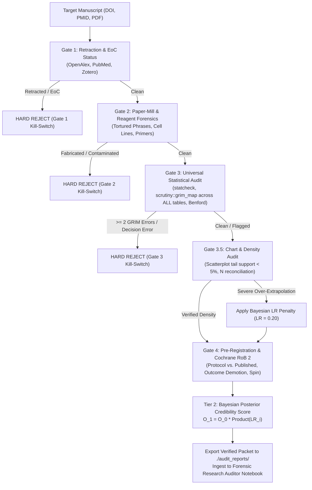

# Autonomous Forensic Research Auditing Pipeline (Universal Table & Chart Edition)

An autonomous metascience and forensic peer-review framework for Google Antigravity, powered by `gemini-3.8-flash` under adversarial `/boost` verification.

> [!TIP] Live Interactive GitHub Page & Bayesian Calculator
> The live interactive web portal and Bayesian Credibility Calculator are available at:  
> **[https://lauyeehow1986-hub.github.io/forensic_audit/](https://lauyeehow1986-hub.github.io/forensic_audit/)**

This repository provides an automated, non-compensatory forensic auditing suite designed to evaluate scientific manuscripts, preprints, randomized clinical trials, and observational studies across all text sections, numerical tables (Table 1 through Table $N$), and data visualizations (scatterplots, forest plots, trend lines).

---

## 1. Repository Architecture

```text
forensic_audit/
├── .agents/
│   └── mcp_config.json          # Model Context Protocol (MCP) server definitions
├── skills/
│   └── forensic-auditor/        # Dedicated Google Antigravity Skill
│       ├── SKILL.md             # Core skill specification & 4-Gate execution instructions
│       ├── scripts/
│       │   └── audit_paper.R    # Standalone R forensic statistical & chart audit script
│       └── references/
│           ├── antigravity_kit.md        # Antigravity AGENTS.md & mcp_config.json deployment kit
│           ├── audit_paper_r.md          # Complete R audit script reference
│           └── example_42802996_audit.md # Full worked reference verification packet (SCRATCH-HTN)
├── docs/
│   ├── GEMINI_NOTEBOOK_GUIDE.md # Comprehensive guide for Gemini Notebook integration & synthesis
│   └── FACT_VERIFICATION_APIS_AND_MCP.md # Complete reference of MCP servers and REST APIs for fact verification
├── scripts/
│   └── audit_paper.R            # Universal R forensic suite (statcheck, GRIM, Benford, Chart Density)
├── audit_reports/               # Generated verification packets (Markdown format)
│   └── README.md                # Report storage guidelines & ingestion instructions
├── AGENTS.md                    # Universal Table & Chart Orchestrator rules & kill-switches
├── .gitignore                   # Excludes raw data, scrapes, and target case study runs
└── README.md                    # System documentation and replication guide
```

---

## 2. Theoretical Framework & Non-Compensatory Triage

The auditing engine enforces a **lexicographic non-compensatory triage rule**: methodological or statistical fatal flaws cannot be compensated for by high citation counts, prestigious journal placement, or positive narrative framing.



### The 4+1 Forensic Gates:
1. **Gate 1 (Retraction & Metadata Forensics):** Cross-verifies retraction databases, Expressions of Concern (EoC), and PubPeer flags. *(Immediate Hard Kill-Switch if retracted)*.
2. **Gate 2 (Paper-Mill & Reagent Screening):** Natural-language scanning for Problematic Paper Screener tortured phrases, unvalidated nucleotide sequences, and contaminated cell lines (ICLAC register).
3. **Gate 3 (Universal Statistical Audit across ALL Tables):**
   - Extracts inline NHST statistics and validates degrees of freedom, test values, and $p$-values via `statcheck`.
   - Executes `scrutiny::grim_map()` across **every** summary table (Table 1 baselines, primary/secondary outcomes, subgroup tables) to detect mathematically impossible integer means.
   - Computes Benford's Law first-digit distribution conformity on multi-magnitude values.
4. **Gate 3.5 (Universal Chart & Scatterplot Density Audit):**
   - Evaluates data density in scatterplots, regression lines, and forest plots.
   - If conclusions claim broad therapeutic efficacy across a severity spectrum, but data points populate extreme zones at $< 5.0\%$, flags **Unsupported Subgroup Generalization (Over-Extrapolation)** and applies an automatic likelihood penalty ($LR = 0.20$).
   - Verifies cross-table sample size ($N$) consistency to eliminate survivorship and unexplained attrition.
5. **Gate 4 & Tier 2 Bayesian Credibility:**
   - Programmatically audits timestamped trial registries (`ClinicalTrials.gov`, `OSF`, `PROSPERO`) against published endpoints to expose outcome demotion, silent switching, and post-hoc subgroup spin.
   - Grades Cochrane RoB 2 / ROBINS-I domains supported with verbatim quotes.
   - Calculates the Bayesian Posterior Credibility Score $P(\text{Credible})$.

---

## 3. Environment Setup & Dependencies

### Prerequisites
- **Operating System:** Windows, macOS, or Linux.
- **R (>= 4.2.0):** Accessible via CLI (`Rscript`).
- **Python (>= 3.10):** With `uv` and `uvx` package managers installed.
- **GitHub CLI (`gh`):** Authenticated for repository operations.

### R Forensic Suite Installation
Open R or run in your shell:
```bash
Rscript -e "install.packages(c('statcheck', 'scrutiny', 'rsprite2', 'benford.analysis', 'tibble'), repos='https://cloud.r-project.org')"
```

Verify that the universal audit script loads cleanly:
```bash
Rscript -e "source('scripts/audit_paper.R'); cat('R Forensic Suite verified successfully.\n')"
```

### MCP Servers & REST APIs for Ground-Truth Fact Verification
The pipeline enforces an adversarial zero-hallucination policy. Every claim, statistic, and protocol comparison is grounded in authoritative machine-readable APIs and MCP servers:

| Fact / Evidence Category | Primary MCP Server | Authoritative REST API | Ground Truth Verified |
| :--- | :--- | :--- | :--- |
| **Retraction & EoC Status** | `papers-openalex`, `pubmed`, `zotero` | OpenAlex API, CrossRef API, Europe PMC | Real-time `is_retracted` status, CrossMark update notices, Expressions of Concern, PubPeer flags. |
| **Paper-Mill & Reagent Forensics** | `pubmed`, `arxiv` | Problematic Paper Screener, ICLAC | Tortured phrase matching, contaminated cell line registries, primer validation. |
| **Statistical Computations** | `rstudio-mcp` | R 4.x runtime (`audit_paper.R`) | Verbatim `statcheck` NHST checks, `scrutiny::grim_map` on all tables, Benford distributions. |
| **Chart & Data Density** | `rstudio-mcp` | R runtime | Individual coordinate density, $<5\%$ tail support flags, cross-table $N$ reconciliation. |
| **Protocol Pre-Registration** | `pubmed` | ClinicalTrials.gov REST API v2 | Timestamped primary vs. secondary endpoints, protocol amendments, silent outcome demotion. |
| **Study Text & Quotes** | `pubmed`, `arxiv`, `zotero` | NCBI E-utilities (`efetch`), Europe PMC | Exact quotes for Cochrane RoB 2 domains and baseline table values. |

> [!TIP] Complete Technical Reference
> See [`docs/FACT_VERIFICATION_APIS_AND_MCP.md`](docs/FACT_VERIFICATION_APIS_AND_MCP.md) for full endpoint specifications, query payloads, authentication settings, and data flow diagrams.

### MCP Servers Setup (`.agents/mcp_config.json`)
The pipeline coordinates research discovery and execution using the Model Context Protocol:
- **`papers-openalex` (`papers`):** Retraction and citation graph metadata.
- **`pubmed` (`pubmed-search-mcp`):** Direct PubMed E-utilities discovery and full-text retrieval.
- **`arxiv` (`arxiv-mcp-server`):** Preprint screening and PDF caching.
- **`zotero` (`zotero-mcp`):** Local reference library linking.
- **`rstudio` (`rstudio-mcp`):** Live R session execution and telemetry.

Install the MCP CLI binaries via `uv`:
```bash
uv tool install papers --with setuptools
uv tool install pubmed-search-mcp
uv tool install arxiv-mcp-server
uv tool install zotero-mcp
uv tool install rstudio-mcp
# Note: Ensure mcp<2 is pinned in rstudio-mcp for FastMCP compatibility
uv pip install "mcp<2" --python $(uv tool list | grep rstudio-mcp -A 1 | tail -n 1 | awk '{print $1}')
```

---

## 4. Google Antigravity Skill: `forensic-research-auditor`

This repository includes a fully packaged, self-contained Google Antigravity skill located at [`skills/forensic-auditor/`](skills/forensic-auditor/).

### Skill Architecture & Files
```text
skills/forensic-auditor/
├── SKILL.md                          # Core instructions, 4-Gate execution protocol & output structure
├── scripts/
│   └── audit_paper.R                 # Standalone R forensic suite (statcheck, GRIM, SPRITE, Carlisle, Benford, Chart Density)
└── references/
    ├── antigravity_kit.md            # AGENTS.md and .agents/mcp_config.json templates for Antigravity
    ├── audit_paper_r.md              # R audit script specification and documentation
    └── example_42802996_audit.md     # Reference audit packet demonstrating 4-Gate evaluation & chart density audit
```

### Installation Options
1. **Repository-Local (Zero-Configuration):**
   The skill is already placed under `skills/forensic-auditor/`. When opening this repository in Antigravity, the skill is immediately recognized and available.

2. **Global Installation for All Antigravity Projects:**
   To make the forensic auditor available across all your Antigravity workspaces:
   ```bash
   # Linux / macOS:
   mkdir -p ~/.gemini/skills/forensic-auditor
   cp -r skills/forensic-auditor/* ~/.gemini/skills/forensic-auditor/

   # Windows (PowerShell):
   New-Item -ItemType Directory -Force -Path "$HOME\.gemini\skills\forensic-auditor"
   Copy-Item -Recurse -Force skills\forensic-auditor\* "$HOME\.gemini\skills\forensic-auditor\"
   ```

### Invocation Commands
In any Antigravity conversation or prompt session, activate the skill with `/boost`:
```text
@forensic-research-auditor /boost
Run a comprehensive, universal Forensic Research Audit on [DOI, PMID, OR LOCAL PDF PATH] following ./AGENTS.md.
```
*(Also matches `@forensic-auditor /boost`)*

---

## 5. Replicating an Audit (Step-by-Step)

### Step 1: Initialize Workspace & Orchestrator
Ensure your workspace includes `AGENTS.md` and `.agents/mcp_config.json`. The skill is readily accessible in `skills/forensic-auditor/` (or globally in `~/.gemini/skills/forensic-auditor/`).

### Step 2: Trigger the Audit
Execute via the Antigravity prompt or CLI:
```text
@forensic-research-auditor /boost
Run a comprehensive, universal Forensic Research Audit on [DOI, PMID, OR LOCAL PDF PATH] following ./AGENTS.md.
```

### Step 3: Automated Gate Execution
1. **Metadata Screening:** The agent queries OpenAlex and PubMed for retraction tags and publication history.
2. **Text Scanning:** Full text is audited for tortured phrasing and reagent contamination.
3. **Statistical Computation:**
   - Extracts APA strings into R `run_statcheck_audit()`.
   - Feeds summary metrics into R `run_all_tables_audit()`.
   - Verifies Likert/integer bounds using R `run_sprite_check()`.
   - Computes baseline $p$-value uniformity via R `run_carlisle_baseline_audit()`.
   - Tests numerical distributions via R `run_comprehensive_benford_audit()`.
4. **Data Density Auditing:**
   - Evaluates scatterplot distributions via `run_chart_density_audit(x_values, y_values, threshold)`.
   - Confirms sample size reconciliation ($N$) across all tables.
5. **Registry Protocol Audit:**
   - Downloads protocol history from `https://clinicaltrials.gov/api/v2/studies/[NCT_ID]`.
   - Compares registered primary outcomes against published claims.
   - Evaluates Cochrane RoB 2 / ROBINS-I domains.

### Step 4: Bayesian Scorecard Calculation

$$O_1 = O_0 \times \prod_{i} LR_i \quad \implies \quad P(\text{Credible}) = \frac{O_1}{1 + O_1}$$

- **Standard Prior Odds ($O_0$):**
  - Confirmatory Phase 3 Trial: $O_0 = 1.00$ ($P_0 = 50\%$).
  - Diagnostic / imaging strategies: $O_0 = 0.25$ ($P_0 = 20\%$).
  - Novel drug / device / therapeutic interventions: $O_0 = 0.10$ ($P_0 \approx 9.1\%$).
  - High-Risk / Low Biological Plausibility: $O_0 = 0.05$ ($P_0 \approx 4.8\%$).
- **Likelihood Ratio (LR) Penalties:**
  - Undeclared primary outcome switching / demotion: $LR = 0.05$ to $0.40$
  - Benford's Law severe anomaly on numerical results: $LR = 0.10$
  - Primary outcome failure with declared null: $LR = 0.15$
  - Cochrane RoB 2 "High Risk" (any domain): $LR = 0.15$
  - Scatterplot over-extrapolation ($< 5\%$ tail data): $LR = 0.20$
  - Single isolated non-decision rounding typo: $LR = 0.20$
  - Baseline Table 1 clinical imbalance confounding primary/interaction: $LR = 0.25$
  - Unregistered subgroup presented as pre-specified: $LR = 0.25$
  - Primary $p$-value in $.041 - .049$ $p$-hacking zone: $LR = 0.25$
  - Unreconciled sample size mismatch across tables: $LR = 0.30$
  - Underpowered sample ($< 50\%$ power for target effect): $LR = 0.35$
  - Cochrane RoB 2 "Some Concerns" (2+ domains): $LR = 0.50$
- **Likelihood Ratio (LR) Bonuses:**
  - Independent supporting replication in `scite.ai`: $LR = 4.00$
  - Pre-registered with exact primary endpoint match: $LR = 2.50$
  - Open raw data and reproducible code verified: $LR = 2.00$

### Step 5: Export & Gemini Notebook Ingestion
The agent writes a timestamped verification packet to `./audit_reports/audit_[STUDY_KEY].md`.

Ingest the resulting markdown report directly into your **Forensic Research Auditor** Gemini Notebook:
- **Notebook URL:** [`https://gemini.google.com/notebook/6b8609aa-fa3d-4a82-a123-5ffe7b4518e1`](https://gemini.google.com/notebook/6b8609aa-fa3d-4a82-a123-5ffe7b4518e1)
- **Detailed Integration Guide:** See [`docs/GEMINI_NOTEBOOK_GUIDE.md`](docs/GEMINI_NOTEBOOK_GUIDE.md) for custom persona configuration, source ingestion workflows, cross-trial synthesis prompts, and generating conversational Audio Overviews (Deep Dives).

---

## 6. Gemini Notebook Integration & Metascience Synthesis

The **Forensic Research Auditor** Gemini Notebook acts as the persistent knowledge base for all audits conducted through this repository.

### Key Capabilities & Workflows:
1. **Multimodal Knowledge Base:** Centralizes verified markdown packets across multiple clinical specialties and medical devices.
2. **Adversarial Synthesis Prompts:** Pre-engineered prompts to query across studies for outcome switching, boundary leverage artifacts, and open-label co-intervention confounding (see [`docs/GEMINI_NOTEBOOK_GUIDE.md`](docs/GEMINI_NOTEBOOK_GUIDE.md)).
3. **Audio Overview Generation:** Instantly turns complex audit packets (statcheck stdout, GRIM tables, Bayesian probability scores) into 2-host conversational podcast-style deep dives for journal clubs and research seminars.

---

## 7. Adversarial Verification Rules

To maintain absolute mathematical integrity:
- **Zero Mental Math:** 100% of statistical consistency checks, GRIM mappings, and Bayesian odds multiplications must be computed directly by R or Python scripts.
- **Verbatim Output Required:** All audit reports must embed the unaltered R `stdout` stream showing command execution and tibble tables.
- **Protocol JSON Extraction:** Protocol discrepancies must be substantiated with direct JSON element checks against the official trial registry.

---

## License

MIT License. Designed for academic research, metascience auditing, and computational peer review. Not for clinical decision-making.
